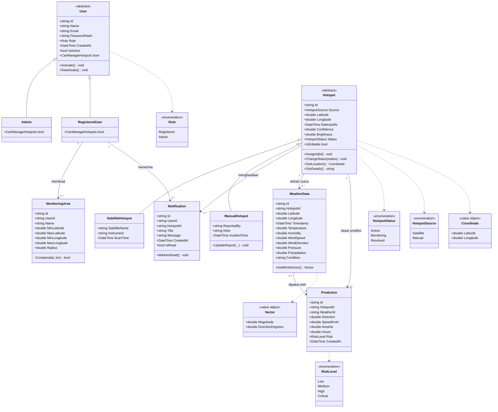
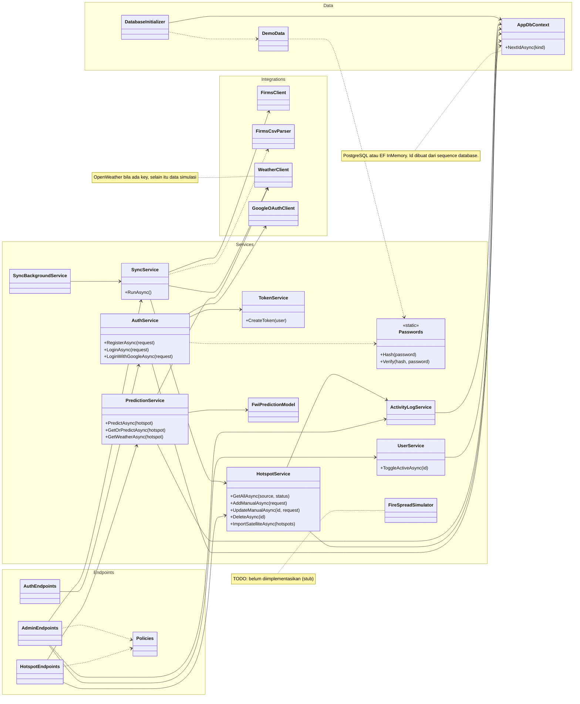
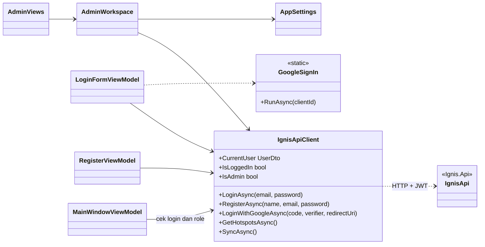

# Class Diagram Ignis

Tiga diagram: **domain** (entity dan relasinya), **server** (service, endpoint, database, integrasi di `Ignis.Api`), dan **desktop** (`Ignis.Frontend`).
Salin blok `mermaid` ke https://mermaid.live atau pratinjau Markdown yang mendukung Mermaid.
Diagram basis data ada di [database.md](database.md); fitur untuk tugas OOP di [oop-feature.md](oop-feature.md); peta lokasi file di [README](../README.md#peta-kode-class-itu-ada-di-mana).

## 1. Domain (`Ignis.Api/Domain`, enum di `Ignis.Shared`)

Catatan: `User` dan `Hotspot` abstrak dengan setter privat (enkapsulasi); `CanManageHotspots`, `IsEditable`, dan `GetDetails()`
dioverride tiap subclass (polimorfisme). Login/registrasi ada di `AuthService`; operasi tambah/ubah/hapus hotspot ada di `HotspotService`.

## 2. Server (`Ignis.Api`)

Service memakai `AppDbContext` langsung (EF Core sudah berperan sebagai repository), tanpa lapisan interface tambahan.

## 3. Desktop (`Ignis.Frontend`)

Arah dependensi proyek: `Frontend → Shared ← Api`. Frontend hanya bicara ke server lewat HTTP.
