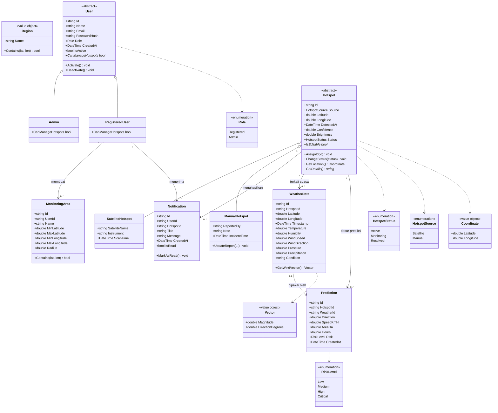
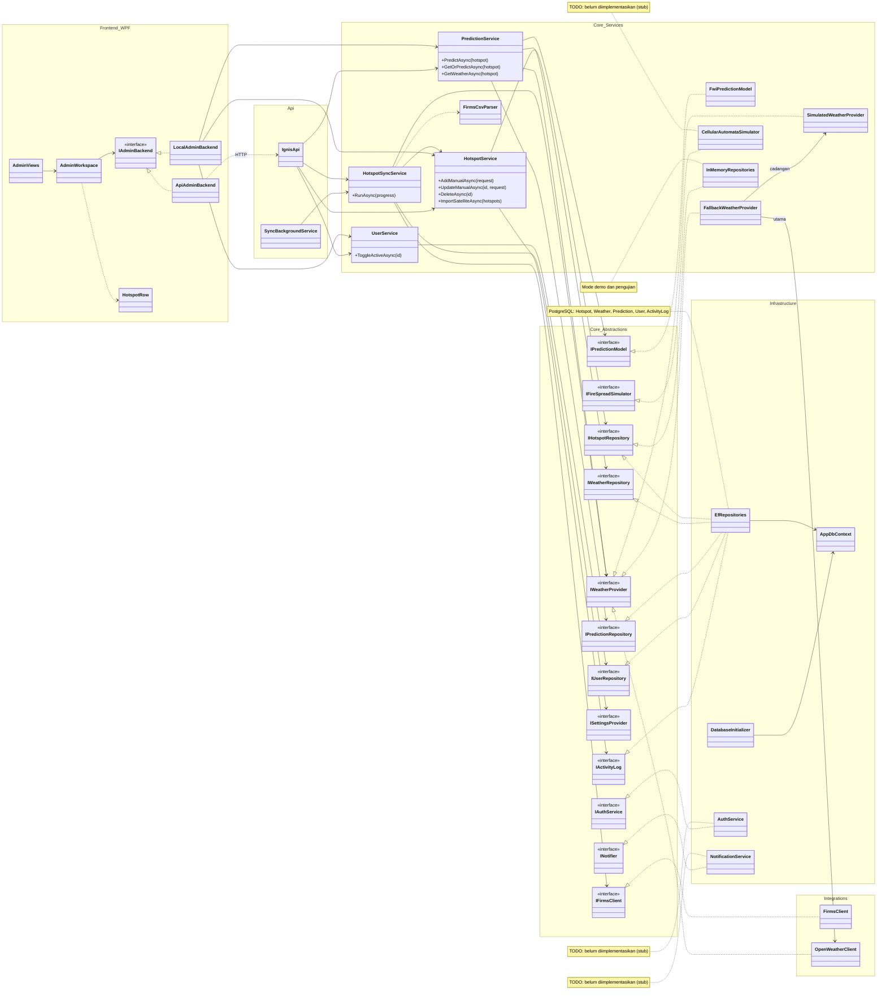

# Class Diagram Ignis (struktur baru)

Dua diagram: **domain** (entity dan relasinya) dan **layanan** (service, interface, implementasi per proyek).
Salin blok `mermaid` ke https://mermaid.live atau pratinjau Markdown yang mendukung Mermaid.
Diagram basis data ada di [database.md](database.md); fitur untuk tugas OOP di [oop-feature.md](oop-feature.md).

## 1. Domain (`Ignis.Core`)

Catatan: `User` dan `Hotspot` abstrak dengan setter privat (enkapsulasi); `CanManageHotspots`, `IsEditable`, dan `GetDetails()`
dioverride tiap subclass (polimorfisme). `login()/logout()` ada di `IAuthService`; operasi tambah/ubah/hapus hotspot ada di `HotspotService`.

## 2. Layanan, interface, dan implementasi

Arah dependensi proyek: `Frontend → Core ← Infrastructure`, `Integrations → Core`, `Api → Core + Infrastructure + Integrations`.
