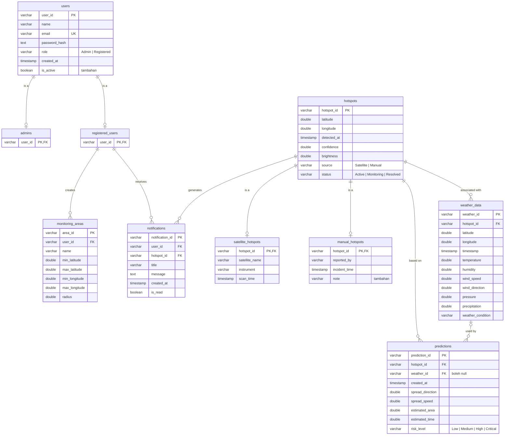

# Database Ignis (PostgreSQL)

Skema mengikuti ERD proyek. Skrip lengkap: [database/schema.sql](../database/schema.sql) (dihasilkan dari
[AppDbContext](../Ignis.Infrastructure/Persistence/AppDbContext.cs)). Tabel dibuat otomatis oleh `Ignis.Api`
saat start bila `Storage:Provider=Postgres`.

## ERD (hasil implementasi)

## Selisih dengan ERD asli

| Hal | Keputusan | Alasan |
|---|---|---|
| Tabel `USER` | dinamai `users` | `user` adalah kata cadangan di PostgreSQL |
| Nama kolom `camelCase` | `snake_case` (`userId` → `user_id`) | konvensi PostgreSQL |
| `users.is_active` | **kolom tambahan** | dipakai fitur aktif/nonaktif pengguna di halaman admin |
| `manual_hotspots.note` | **kolom tambahan** | catatan pada form hotspot manual |
| tabel `activity_log` | **tabel tambahan** | log aktivitas di halaman pengguna |
| relasi `MONITORING_AREA` ↔ `HOTSPOT` ("monitors / refers to") | **tidak punya FK** | di ERD tidak ada kolom penghubung; dihitung secara spasial lewat `MonitoringArea.Contains(lat, lon)` |
| `predictions.weather_id` | boleh `NULL` | data prediksi contoh tidak punya baris cuaca; bila cuaca dihapus nilainya jadi `NULL` |
| Hapus hotspot | menghapus anak-anaknya (cuaca, prediksi, notifikasi) lewat `ON DELETE CASCADE` | FK `hotspot_id` pada ERD wajib terisi |
| Pewarisan tabel | `hotspot_id`/`user_id` di tabel anak = PK sekaligus FK | sesuai ERD (`PK,FK`) |

Usul: tambahkan `is_active`, `note`, dan `activity_log` ke ERD resmi agar dokumen dan database sama.

## Aturan data yang dijaga database

`CHECK` pada `hotspots` (lat −90..90, lon −180..180, confidence 0..100, `source`, `status`), `users.role`,
`predictions.risk_level`, dan `monitoring_areas` (min ≤ max, radius ≥ 0); email pengguna unik; hotspot satelit unik
per `(detected_at, latitude, longitude)` (mencegah impor FIRMS ganda).

## Menyalakan PostgreSQL

Lihat bagian "Menjalankan" di [README](../README.md).
