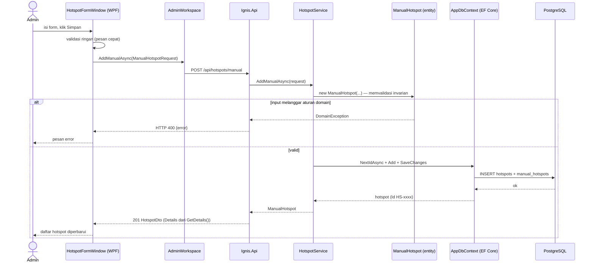
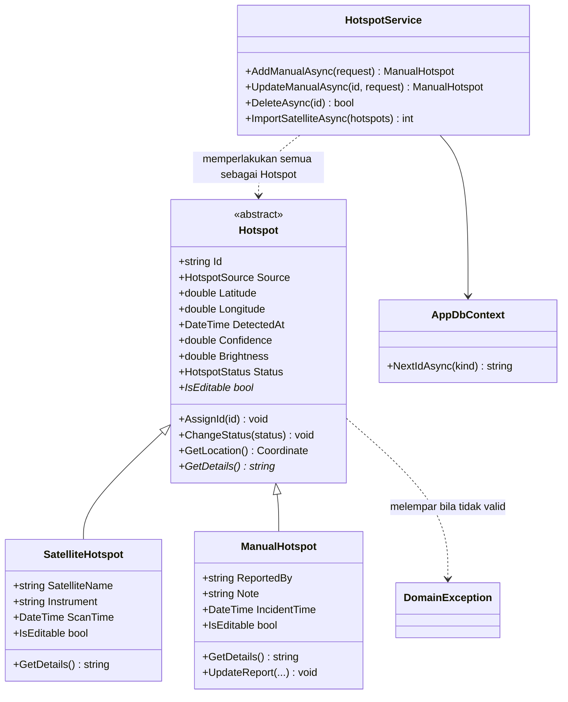

# Fitur Tugas OOP: Manajemen Hotspot

Fitur: **admin menambah, mengubah, dan menghapus hotspot manual**, sedangkan hotspot satelit (NASA FIRMS) hanya dibaca.
Seluruh data disimpan di PostgreSQL. Alurnya: `WPF (form admin)` → HTTP → `Ignis.Api` → `HotspotService` → entity `Hotspot` → `AppDbContext` (EF Core) → PostgreSQL. Endpoint tambah/ubah/hapus hanya untuk akun Admin (token JWT).

Method utama: `HotspotService.AddManualAsync` ([Ignis.Api/Services/HotspotService.cs](../Ignis.Api/Services/HotspotService.cs)).

## Di mana tiga konsep itu diterapkan

| Konsep | Penerapan | Berkas |
|---|---|---|
| **Inheritance** | `Hotspot` (abstrak) diturunkan menjadi `SatelliteHotspot` dan `ManualHotspot`. `User` (abstrak) diturunkan menjadi `Admin` dan `RegisteredUser`. Sama seperti ERD (tabel anak berbagi PK/FK dengan tabel induk). | [Hotspot.cs](../Ignis.Api/Domain/Hotspot.cs), [User.cs](../Ignis.Api/Domain/User.cs) |
| **Encapsulation** | Semua properti `Hotspot`/`User` bersetter privat. Nilai berubah hanya lewat konstruktor dan method (`UpdateReport`, `ChangeStatus`, `AssignId`, `Activate`/`Deactivate`) yang memvalidasi invarian (lat/lon, confidence 0–100, pelapor wajib, Id hanya sekali). `UpdateReport` bersifat atomik: input tidak valid tidak mengubah apa pun. | [Hotspot.cs](../Ignis.Api/Domain/Hotspot.cs), [DomainException.cs](../Ignis.Api/Domain/DomainException.cs) |
| **Polymorphism** | `Hotspot.IsEditable` dan `Hotspot.GetDetails()` abstrak, tiap subclass punya perilaku sendiri. `HotspotService.DeleteAsync` cukup memanggil `existing.IsEditable` tanpa `if` per jenis. `User.CanManageHotspots` juga polimorfik. | [HotspotService.cs](../Ignis.Api/Services/HotspotService.cs) |

Bukti perilakunya ada di unit test: [HotspotOopTests](../Ignis.Tests/DomainTests.cs) (`dotnet test Ignis.Tests`).

## Alur "tambah hotspot manual"

## Diagram kelas fitur

## Mencoba

Lihat bagian "Menjalankan" di [README](../README.md). Singkatnya: nyalakan PostgreSQL, jalankan `Ignis.Api` dengan
`Storage__Provider=Postgres`, jalankan `Ignis.Frontend`, login `admin@ignis.example` / `Ignis@123` (akun demo), buka **Kelola Hotspot** lalu **Tambah Hotspot**.
Hasilnya bisa dicek langsung di database: `SELECT * FROM hotspots h JOIN manual_hotspots m USING (hotspot_id);`
